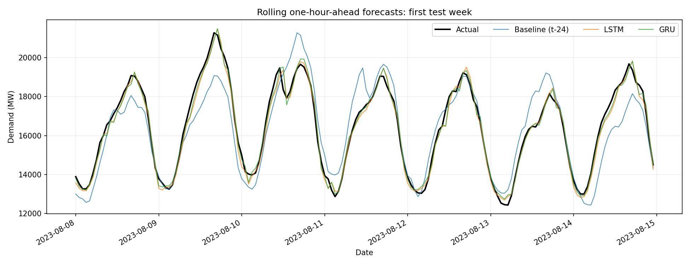
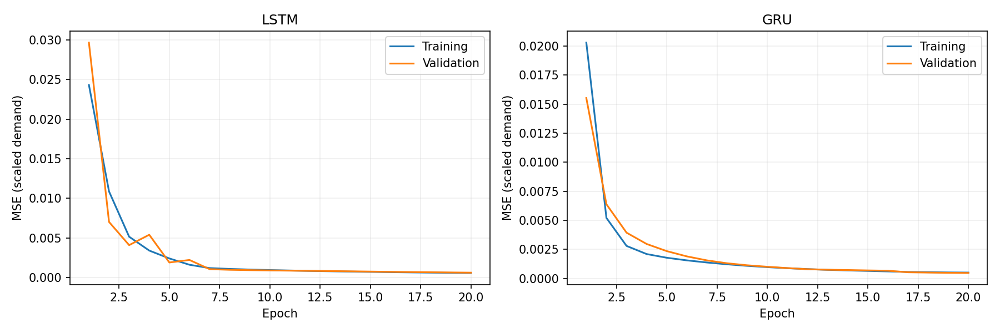

# Ontario electricity load forecasting

A basic Python notebook predicting hourly Ontario demand (MW) one hour ahead, comparing a previous-day baseline, LSTM and GRU. All notebook cells have been executed; the displayed results are from this run.

## Data

Real IESO **Ontario Demand**, 2022–2023: [report directory](http://reports.ieso.ca/public/Demand/), [2022 CSV](http://reports.ieso.ca/public/Demand/PUB_Demand_2022.csv), [2023 CSV](http://reports.ieso.ca/public/Demand/PUB_Demand_2023.csv).

17,520 hourly observations, 2022-01-01 00:00:00 through 2023-12-31 23:00:00. Original reports and the cleaned `ontario_hourly_demand.csv` are in `data/`. IESO hours 1–24 are mapped to interval starts 00:00–23:00 without timezone conversion. HTTPS returned HTML; the requested HTTP endpoint supplied valid CSVs. No fallback or synthetic data was used.

## Method

- Sort the hourly series, average duplicate timestamps, and interpolate gaps up to three hours (none were present in these files).
- First 80% of hours for training/validation, last 20% for testing; final 10% of the training part for validation. No shuffling.
- Fit MinMaxScaler only on fitting data. Use the previous 24 hours to predict the next hour.
- Baseline: same hour yesterday. LSTM/GRU: 50 units + Dense(1), Adam, MSE, batch 64, at most 20 epochs, early stopping (patience 3).
- Seed 42 for NumPy/TensorFlow. Evaluate rolling one-hour forecasts in real MW; each prediction can use demand already observed in the test period.

## Results

| Model | MAE (MW) | RMSE (MW) | MAPE (%) |
|---|---:|---:|---:|
| Baseline (t-24) | 761.04 | 1024.27 | 4.82 |
| LSTM | 218.25 | 286.38 | 1.38 |
| GRU | 196.68 | 256.25 | 1.24 |

GRU had the lowest test RMSE in this run. The recurrent models use the latest 24 hours, allowing them to follow recent changes that yesterday's same hour misses. The relative ranking is specific to this test period; weather and holidays are not model inputs.





EDA plots are saved in `results/eda.png`; full precision results are in `results/metrics.csv`.

## Run

Tested with Python 3.11 (TensorFlow 2.15). Create/select a virtual environment in VS Code, then install:

```bash
python -m pip install -r requirements.txt
```

Open `notebook.ipynb`, select that environment as the Python kernel, and run all cells. The included `.venv` is already configured in this workspace. The notebook uses saved CSVs if present, so rerunning does not require another download. CPU thread limits keep training small; numerical results can vary with hardware or software versions.
